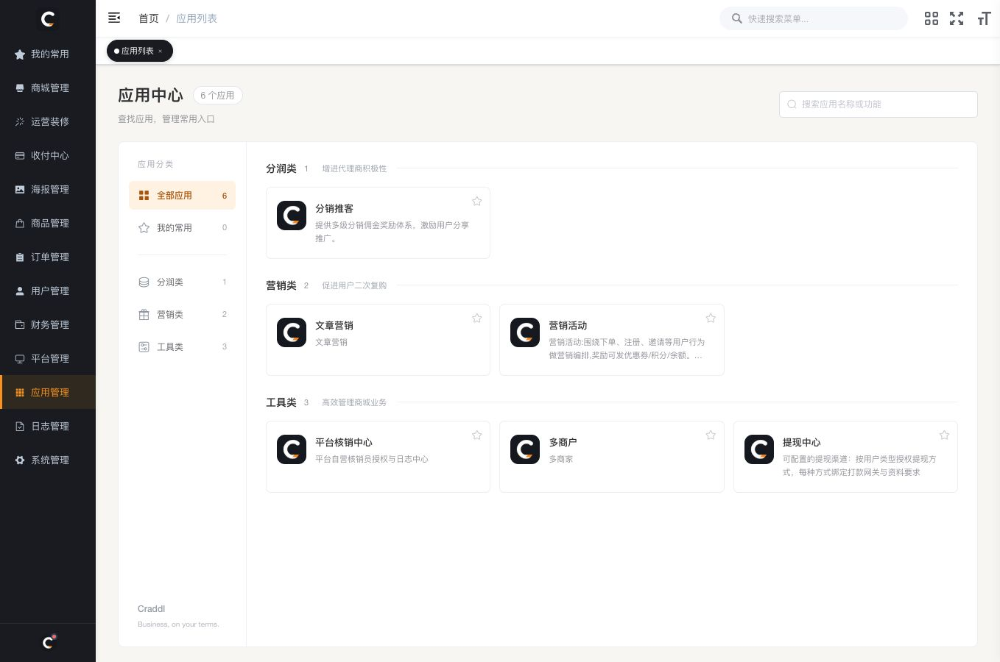
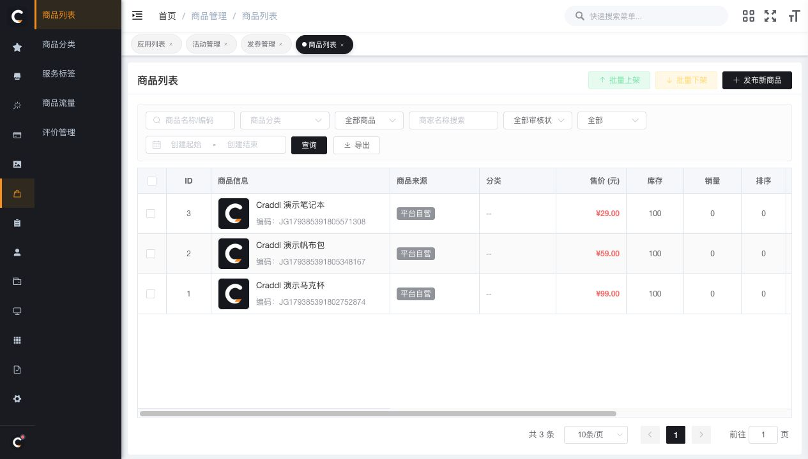
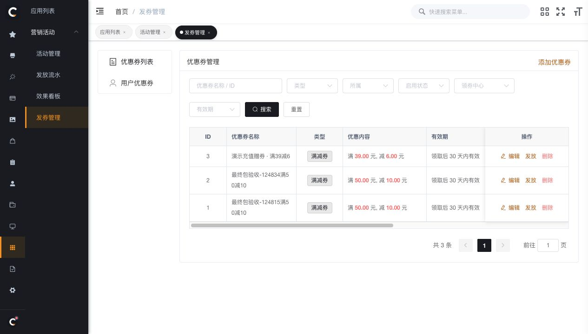
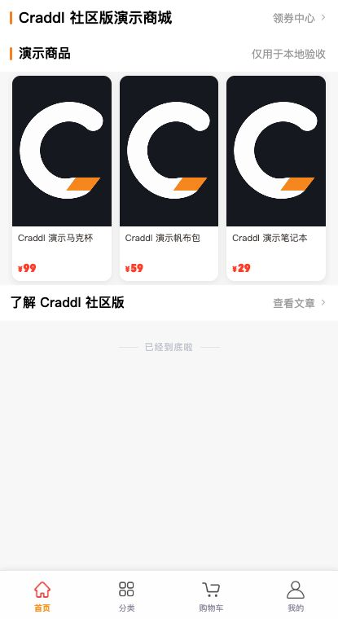

# Craddl 社区版

Craddl 社区版是一套可自部署的开源多商户商城，包含平台后台、商家后台、移动商城和任务调度器。平台可管理商品、订单及入驻商户，并通过社区应用开展优惠券营销、分销、核销和提现业务。

[安装部署与手动升级](INSTALL.md) · [问题反馈](https://github.com/bonniehsx-bit/craddl-community/issues) · [官网](https://www.craddl.cn/)

## 平台后台

截图来自本地社区版演示环境，图中的商品、价格和优惠券均为演示数据。

### 应用中心

社区版包含多商户、营销活动、文章营销、分销推客、平台核销和提现中心六个应用。

### 商品管理

平台可查看商品来源、售价和库存，并从列表管理商品上下架。

### 优惠券管理

在营销活动中配置优惠门槛、有效期、适用范围和发放方式。

## 移动商城

H5 演示首页展示商品、领券入口、内容入口和购物车导航。

## 安装

从源码开始部署时，按 [安装说明](INSTALL.md) 准备 PHP、MySQL、Redis 和构建环境，再初始化数据库、构建后台与商城，并启动 [社区调度器](scheduler/README-community.md)。移动端发布参数和升级回滚步骤也列在安装说明中。

## 许可证

项目发起人 **Jimmy G**。佛山今日鼎盛信息科技有限公司以 [CPAL-1.0](LICENSE) 授权本社区版中有权许可的 Craddl 自有代码。界面署名和源码提供义务见 [源码许可说明](api/SOURCE-LICENSE.md)。第三方组件和资源保留各自的许可与署名，详见 [第三方许可声明](THIRD-PARTY-NOTICES.md)。
